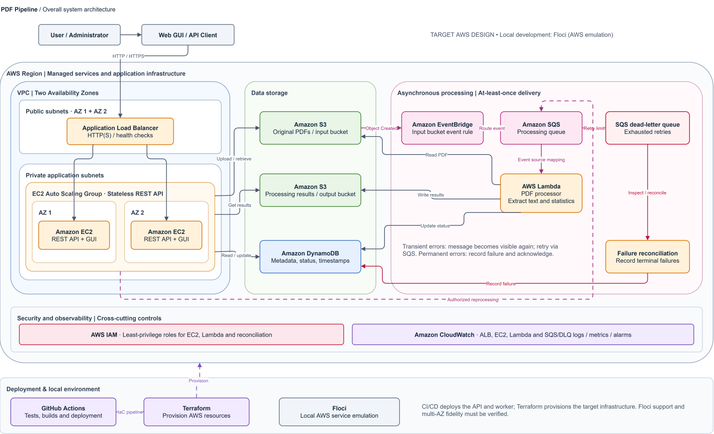
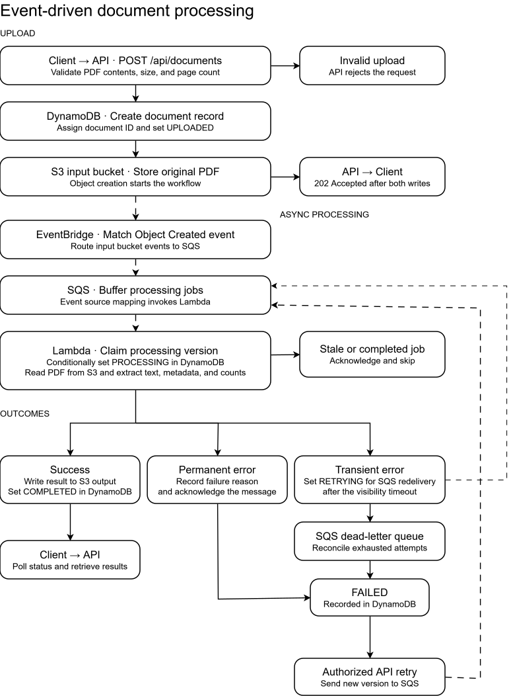

# PDF Pipeline Architecture

This document describes the proposed architecture for [PDF Pipeline](../README.md). The first deployment will run locally against Floci. An AWS deployment is an optional milestone. The [system requirements](./system-requirements.md) define the API, interface, and acceptance targets.

## Components

| Component | Responsibility |
| --- | --- |
| Web GUI | Uses HTML, CSS, Bootstrap, and vanilla JavaScript to provide upload progress, status polling, results, downloads, deletion, and authorized retry through the REST API. |
| VPC, ALB, and EC2 Auto Scaling group | Span two Availability Zones. The public ALB routes traffic to healthy EC2 instances in private application subnets. |
| REST API | Serves the GUI assets, validates uploads, manages documents, enforces administrative authorization, and exposes `/health`. The application is stateless. |
| S3 | Stores original PDFs and processing results in separate private buckets. The API mediates user access to both. |
| DynamoDB | Stores document metadata, processing state, timestamps, failure reasons, and references to S3 objects. |
| EventBridge | Routes `Object Created` events from the S3 input bucket to the processing queue. |
| SQS and dead-letter queue | Buffer work, support redelivery after transient failures, and retain messages that exhaust delivery attempts for inspection. |
| Lambda | Reads originals, extracts text and metadata, counts words and characters, writes results, and updates document state. Worker capacity scales separately from the API. |
| Failure reconciliation | Uses dead-letter queue messages to record terminal processing failures in DynamoDB. |
| CloudWatch | Collects structured logs and metrics, supports dashboards, and raises alarms on configured thresholds. |

## Request and processing flow

1. A client uploads a PDF to `POST /api/documents`. The API validates the file contents and enforces the 10 MB and 100-page limits.
2. The API assigns a document ID, creates the DynamoDB record in `UPLOADED`, and writes the original to its S3 input key. Creating the record first lets the worker resolve the document even if the event arrives before the HTTP response. The API returns HTTP `202 Accepted` with processing still asynchronous once both writes succeed.
3. The input bucket emits an `Object Created` event. An EventBridge rule routes it to the SQS processing queue, whose event source mapping invokes Lambda. The processor uses the input key to resolve the document and its initial processing version. It claims that version in DynamoDB before reading the PDF.
4. The worker extracts text, page count, file size, and embedded title and author when available. It calculates word and character counts, writes the result to the S3 output bucket, and conditionally records the metadata, result reference, and completion timestamp in DynamoDB.
5. The GUI polls the API for status. Clients retrieve metadata and download the original or results using the documented REST endpoints. A result becomes available after the worker records `COMPLETED` and its result reference.

Processing covers embedded text, PDF metadata, and document statistics. OCR for scanned pages, AI summarization, editing, and format conversion are outside the initial scope.

## State, retries, and deletion

The [document lifecycle diagram](./diagram.png) shows the processing states. `UPLOADED` is the initial document state. `QUEUED`, if implemented, indicates dispatch to the processing queue. `PROCESSING` indicates a worker claim. `RETRYING` indicates a transient error pending redelivery. `COMPLETED` indicates a stored result. `FAILED` records a permanent error or exhausted delivery attempts. DynamoDB is authoritative for the current state.

- **Duplicate delivery and worker recovery.** Use conditional DynamoDB writes and processing versions to handle duplicate, delayed, and out-of-order messages. A redelivered message can reclaim an expired worker claim. Use deterministic result keys scoped to the processing version and claim so a stale worker cannot overwrite a committed result or advance state.
- **Failure handling.** Use a baseline of three processing attempts, a 60-second Lambda timeout, a 360-second SQS visibility timeout, and four-day processing queue retention. Report transient failures per message so SQS can retry them independently. Record permanent failures in DynamoDB and acknowledge their messages. When SQS moves an exhausted job to the dead-letter queue, reconcile its active processing version to `FAILED` and make failure details available for administrative inspection.
- **Administrative retry.** `POST /api/documents/{id}/retry` checks administrator authorization and confirms the document is `FAILED`. The API prepares a new processing version and sends the job directly to the processing queue. The job reuses the original PDF. Earlier versions cannot update the current result or state.
- **Deletion.** Allow deletion in terminal states (`COMPLETED` and `FAILED`). Coordinate deletion and manual retry through conditional state checks. Remove the original, any results, and the metadata, and make cleanup safe to retry after a partial failure.

Implementation must define recovery for partial uploads and for a manual retry whose DynamoDB update succeeds but whose SQS send fails.

## Deployment and security

**Local.** Run the application against Floci using configurable AWS endpoints and AWS-compatible SDKs. Use Terraform to provision supported integrations and keep environment-specific settings outside business logic.

**AWS.** Place the ALB in public subnets across two Availability Zones and serve production client traffic over HTTPS. Run the GUI and REST API on stateless EC2 instances in private application subnets across both zones. The ALB checks `/health` and routes traffic to healthy targets. Reusable Terraform modules provision the network, application infrastructure, storage, event routing, workers, and monitoring.

Use least-privilege roles for the EC2 application, Lambda processor, and failure reconciliation. Block public access to S3 and encrypt production document and result storage at rest. Keep credentials outside source control and out of the browser. Validate uploads as untrusted input, bound parser resource use, and enforce administrative authorization in the API.

## Observability and validation

- Include the document ID in structured logs across ingestion, publication, processing, and retries. Record state transitions and durations without logging credentials or extracted text.
- Monitor request counts and error rates, queue depth and age, processing duration, and DLQ activity. Configure CloudWatch dashboards and alarms for operational thresholds.
- Use GitHub Actions for application tests, builds, and deployment validation for the API and worker, along with Terraform formatting and validation. Exercise the API and GUI workflows, input bucket event routing, duplicate delivery, worker failure, and retry exhaustion in Floci where supported. Verify emulator support for each integration before relying on it.
- Measure the proposed latency, throughput, and concurrency targets under load. Validate multi-AZ failover, scaling, IAM enforcement, encryption, and performance in AWS if deployed.
